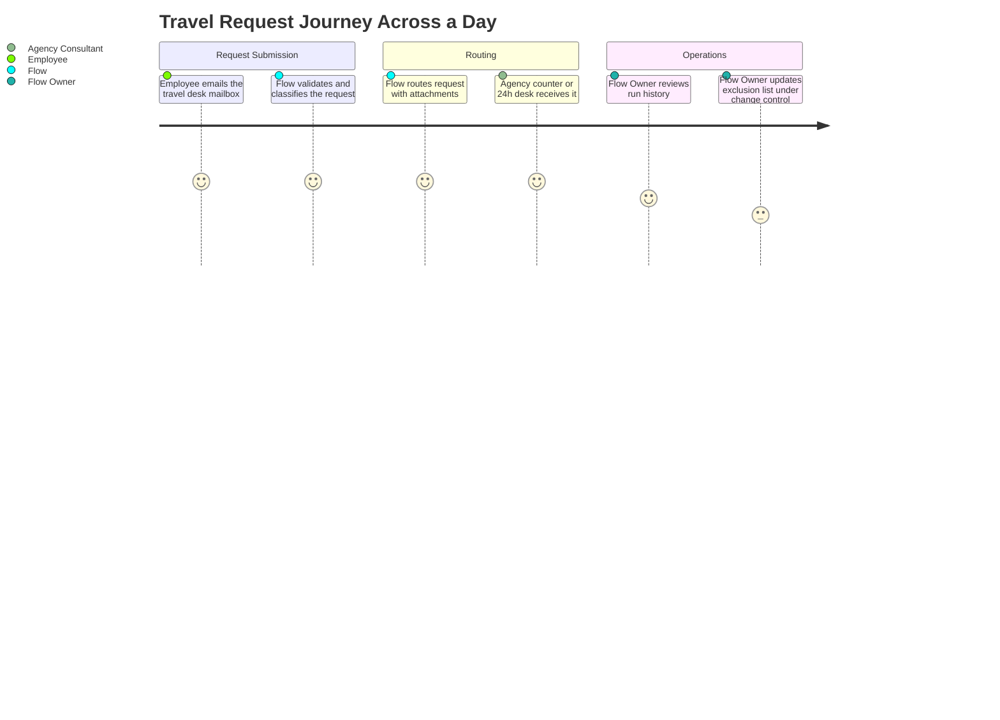
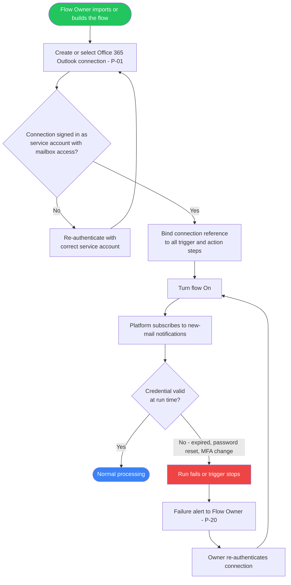
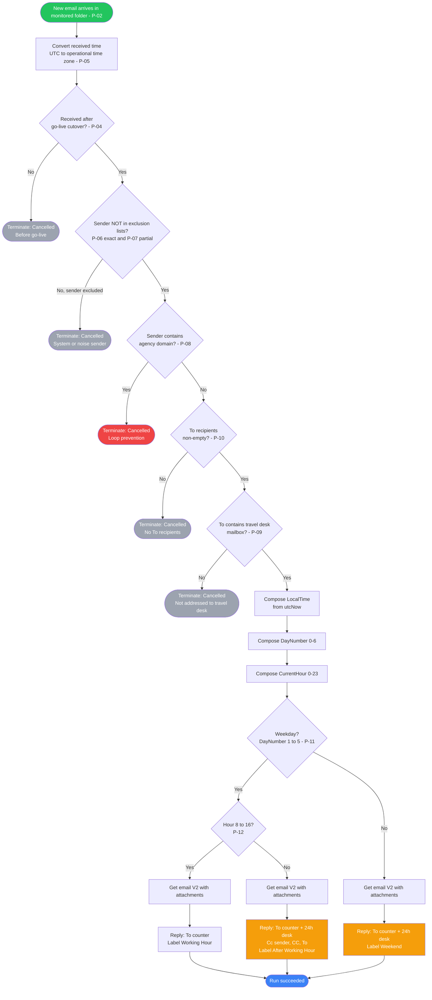
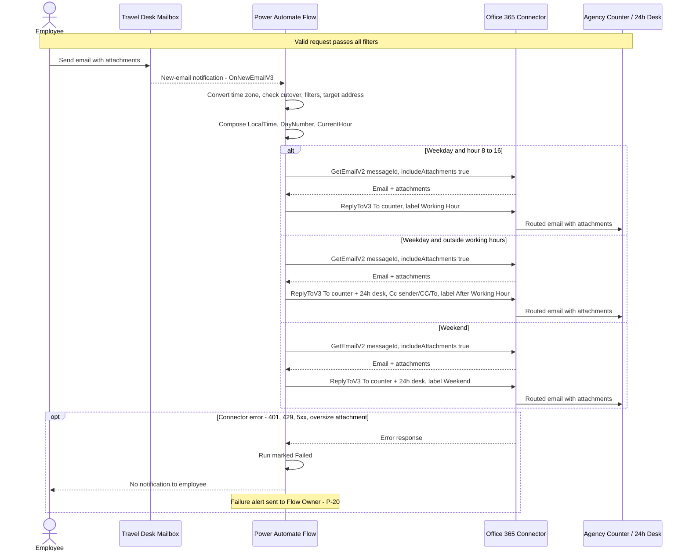
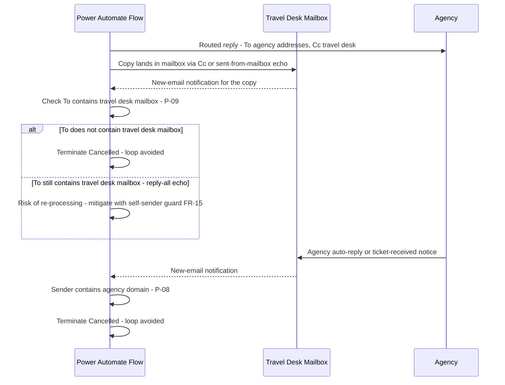
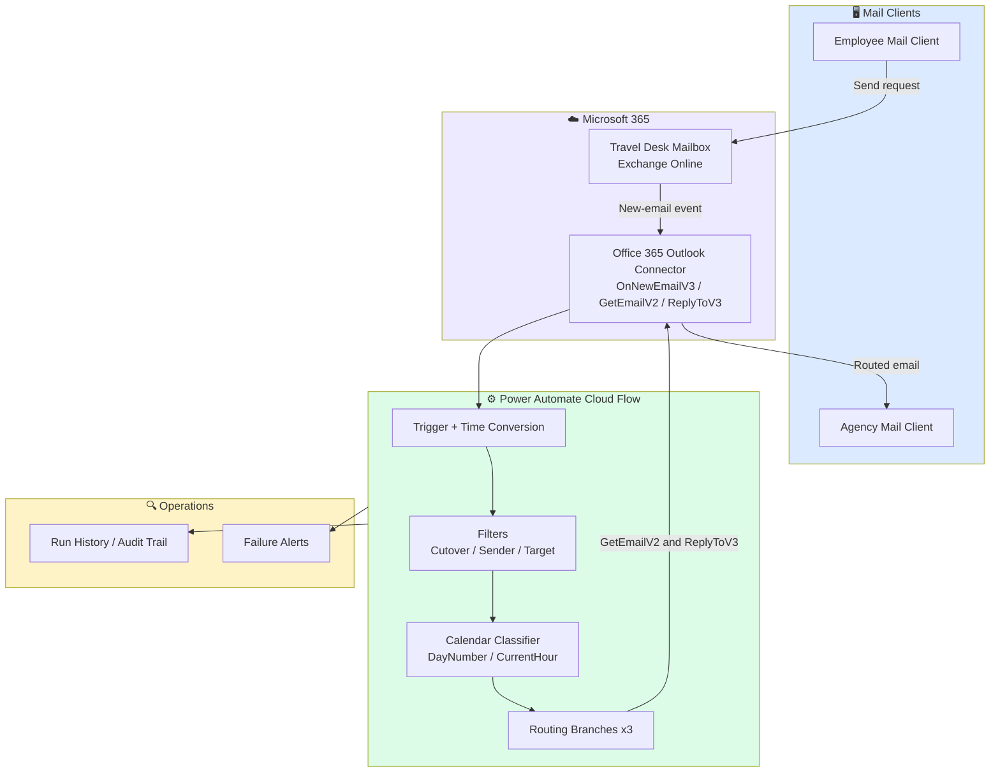
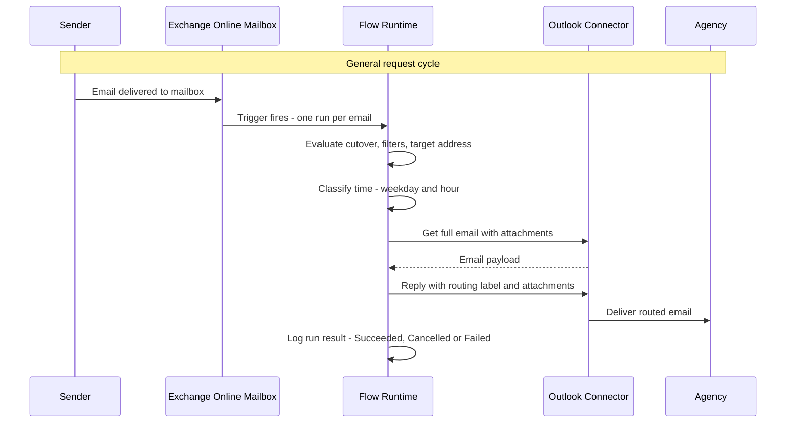
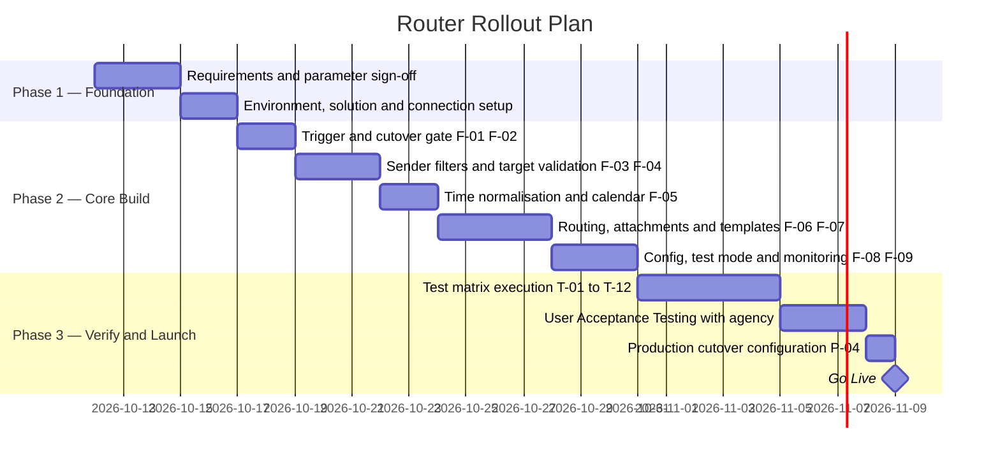

# PRD — Travel Booking Mail Router V2 (Power Automate)
> **Version:** 1.0.0 | **Status:** 🟡 Draft | **Last Updated:** 2026-10-10  
> **Author:** [TBD] | **Reviewer:** [TBD] | **Stakeholder:** [TBD]

---

## Table of Contents
1. [Overview](#1-overview)
2. [Goals & Success Metrics](#2-goals--success-metrics)
3. [Requirements](#3-requirements)
4. [Core Features](#4-core-features)
5. [User Roles & Permissions](#5-user-roles--permissions)
6. [User Flow](#6-user-flow)
7. [Screen & UI Breakdown](#7-screen--ui-breakdown)
8. [Architecture](#8-architecture)
9. [Database Schema](#9-database-schema)
10. [API Endpoints](#10-api-endpoints)
11. [Design & Technical Constraints](#11-design--technical-constraints)
12. [Out of Scope](#12-out-of-scope)
13. [Risks & Mitigations](#13-risks--mitigations)
14. [Timeline & Milestones](#14-timeline--milestones)
15. [Open Questions](#15-open-questions)

> **Reading note:** This PRD is intentionally **generic**. No real mailbox addresses, domains or company names appear in it. Every environment-specific value is represented by a **configuration parameter ID (P-01 … P-20)** defined in [Section 11.5](#115-configuration-parameters--parts-to-edit). Section 11.5 is the single source of truth for *what must be edited* before the flow is deployed, tested or changed.

---

## 1. Overview

### Problem Statement
> *Describe the core problem being solved. Who is affected, and what happens if it remains unsolved?*

Employees send business-travel requests (flights, hotels, itineraries) to a central travel-desk mailbox. An external travel agency fulfils those requests, but the agency runs two service tiers: a standard counter during business hours and a 24/7 desk for urgent after-hours and weekend cases. Today a human has to read each incoming email, decide which tier applies, and forward it manually with the attachments.

Consequences if unsolved:
- Requests sent outside business hours wait until the next working day, causing missed ticketing windows and SLA breaches.
- Manual forwarding is error-prone (wrong recipient, missing attachments, no consistent routing label).
- Automated mail (HR system notifications, airline notices, agency replies) pollutes the mailbox and, if naively automated, can create **infinite forwarding loops**.
- There is no audit trail of *when* and *to whom* each request was routed.

### Solution Summary
> *A 2–3 sentence summary of the proposed solution.*

Travel Booking Mail Router V2 is a headless Microsoft Power Automate cloud flow that watches the travel-desk mailbox, filters out system/loop-prone senders, classifies each valid request by Jakarta-style local time (business day + business hour), and routes it with all original attachments to the agency's standard counter or to both the standard counter and the 24/7 desk. Each routed message carries a routing label so the agency can instantly see which tier the request fell into.

### Target Users
| Persona | Description | Primary Need |
|---------|-------------|--------------|
| Corporate Employee (Requester) | Any staff member who emails a travel request to the central travel-desk mailbox | Request handed to the agency immediately, at any hour, with attachments intact |
| Agency Travel Consultant | External agent at the standard counter or the 24/7 desk | Clear routing label and complete payload so urgent after-hours requests are prioritised correctly |
| Flow Owner / Maintainer | HR-tech / IT automation owner of the flow | Safe, documented way to change routing parameters, test, deploy and monitor without breaking production |
| Travel Desk Operator (Observer) | Internal travel-desk staff who own the mailbox | Visibility of what was routed, and when, without doing it by hand |

---

## 2. Goals & Success Metrics

### Business Goals
- [ ] Automate 100% of valid employee travel requests received by the central travel-desk mailbox (zero manual triage).
- [ ] Guarantee tier-correct routing: business-day/business-hour requests to the standard counter; after-hours and weekend requests to the standard counter **and** the 24/7 desk.
- [ ] Eliminate automated-mail loops and system-notification noise from the routing path.
- [ ] Provide an auditable, parameter-driven design so routing rules can be changed under change control, not by rewriting logic.

### Key Performance Indicators (KPIs)
| Metric | Current Baseline | Target | How to Measure |
|--------|-----------------|--------|----------------|
| Routing Accuracy Rate (North Star) — valid emails routed to the correct tier without human intervention | None (new process; manual baseline to be sampled during UAT) | > 99.5% | UAT test matrix + monthly sample audit comparing run history to mailbox contents |
| End-to-end latency (email received → routed reply sent) | Manual: hours (not measured) | < 60 seconds (p95) | Run history: trigger time vs. action end time of the reply action |
| False Positive Exclusion Rate — legitimate requests wrongly dropped by filters | None (new process) | < 0.1% | Monthly review of runs ending in "Cancelled" against the mailbox |
| Loop Incidents — runs triggered by the flow's own or agency's automated mail | None (new process) | 0 | Run history review; alert on > N runs/hour from same sender |
| Attachment Retention Rate — routed emails whose attachment count equals the original | None (new process) | 100% | UAT matrix; spot-check of routed mail |
| Failed-run Detection Time | None (new process) | < 1 business hour to notification | Failure-alert timestamp vs. failed run timestamp |

---

## 3. Requirements

### Functional Requirements
| ID | Category | Requirement | Priority |
|----|----------|-------------|----------|
| FR-01 | Trigger | The flow must start on every new email arriving in the configured mailbox folder (default: Inbox) with attachments included in the trigger payload (P-01, P-02, P-03). | 🔴 Must Have |
| FR-02 | Cutover | The flow must terminate (status Cancelled) for any email received before the configured go-live timestamp, evaluated in the operational time zone (P-04, P-05). | 🔴 Must Have |
| FR-03 | Time Normalisation | The flow must convert the inbound UTC timestamp to the operational time zone before any date-based comparison (P-05). | 🔴 Must Have |
| FR-04 | Sender Filtering | The flow must terminate if the sender matches any entry in the excluded-sender exact-match list or the excluded-sender partial-match list (P-06, P-07). | 🔴 Must Have |
| FR-05 | Loop Prevention | The flow must terminate if the sender address contains the agency domain (P-08). | 🔴 Must Have |
| FR-06 | Target Validation | The flow must proceed only if the To-recipients field is non-empty (P-10) and contains the travel-desk mailbox address (P-09); otherwise terminate. | 🔴 Must Have |
| FR-07 | Business Calendar | The flow must classify the current day as weekday when DayNumber > 0 and DayNumber < 6 (Sunday = 0, Saturday = 6) (P-11). | 🔴 Must Have |
| FR-08 | Working-Hour Routing | On a weekday with hour ≥ 8 and < 17, the flow must reply to the standard counter address with the "Working Hour" label (P-12, P-13, P-17). | 🔴 Must Have |
| FR-09 | After-Hour Routing | On a weekday outside the working-hour window, the flow must reply to the standard counter **and** the 24/7 desk, copy the original sender, CC and To recipients, and use the "After Working Hour" label (P-14, P-15, P-17). | 🔴 Must Have |
| FR-10 | Weekend Routing | On Saturday/Sunday, the flow must reply to the standard counter **and** the 24/7 desk with the "Weekend" label (P-14, P-17). | 🔴 Must Have |
| FR-11 | Attachment Retention | The flow must retrieve the full email via the Get Email operation with attachments and append all original attachments to the routed reply (P-18). | 🔴 Must Have |
| FR-12 | Payload Decoration | The routed message must contain a fixed greeting, an "automatically generated" notice, the routing label and the original email body, using paragraph-formatted HTML (P-17). | 🔴 Must Have |
| FR-13 | Test Mode | The flow must support a documented test mode (overrides for day, hour, sender filter, target mailbox, cutover) that can be reverted to production values without logic changes (P-19). | 🟠 Should Have |
| FR-14 | Monitoring | Failed runs must notify the Flow Owner; Cancelled runs must be reviewable for false-positive analysis (P-20). | 🟠 Should Have |
| FR-15 | Self-Sender Guard | *(Hardening — not in V2 baseline)* The flow should terminate if the sender equals the travel-desk mailbox itself, protecting against reply-all echo loops. | 🟠 Should Have |
| FR-16 | Case-Insensitive Matching | *(Hardening — not in V2 baseline)* Sender comparisons should be normalised with lower-case conversion before matching exclusion lists. | 🟠 Should Have |
| FR-17 | Externalised Configuration | *(Future)* Exclusion lists, recipients and cutover time should be stored in environment variables or a managed list instead of inline expressions. | 🟡 Nice to Have |
| FR-18 | Public Holiday Calendar | *(Future)* Treat official public holidays as non-working days. | 🟡 Nice to Have |

**Priority Legend:**
- 🔴 **Must Have** — Required for MVP; the system cannot function without it
- 🟠 **Should Have** — Important but can be deferred to the next iteration
- 🟡 **Nice to Have** — Improves experience but is not a priority

### Non-Functional Requirements
| Category | Requirement | Target |
|----------|-------------|--------|
| **Performance** | Latency from email arrival to routed reply sent | < 60 seconds (p95) |
| **Accessibility** | Interaction channel | Standard email client rendering only (no custom UI); routed HTML must render in common desktop and mobile clients |
| **Security** | Authentication method | Delegated Office 365 Outlook connection owned by a dedicated service/shared-mailbox account; no secrets stored in the flow |
| **Security** | Data handling | Pass-through only: email body and attachments are not persisted in any secondary store |
| **Scalability** | Expected volume | [TBD per site — to be sized in UAT]; bounded by the Power Automate licence plan limits |
| **Availability** | Uptime | Follows Microsoft 365 / Power Automate service SLA; flow turned **On** continuously; failed-run alert < 1 business hour |
| **Auditability** | Execution traceability | 100% of runs visible in run history (platform-retained, typically 28 days); longer retention via periodic export if required by policy |
| **Maintainability** | Change control | Every parameter change recorded in the Changelog and approved per change-management procedure |

---

## 4. Core Features

### Feature List

| ID | Feature | Brief Description | Priority | Status |
|----|---------|-------------------|----------|--------|
| F-01 | Mailbox Trigger & Ingestion | Fire on each new email in the monitored folder with attachments | 🔴 Must Have | 🔲 Not Started |
| F-02 | Go-Live Cutover Gate | Ignore emails received before the configured go-live timestamp | 🔴 Must Have | 🔲 Not Started |
| F-03 | Sender Filtering & Loop Prevention | Drop system senders, airline/notification domains and agency-domain senders | 🔴 Must Have | 🔲 Not Started |
| F-04 | Target Address Validation | Proceed only if the travel-desk mailbox is in the To field | 🔴 Must Have | 🔲 Not Started |
| F-05 | Time Normalisation & Calendar Classification | Convert time zone, derive day number and hour, classify weekday / hour window | 🔴 Must Have | 🔲 Not Started |
| F-06 | Time-Based Routing (3 Routes) | Working Hour, After Working Hour, Weekend routes with distinct recipients and labels | 🔴 Must Have | 🔲 Not Started |
| F-07 | Attachment Retention & Message Composition | Re-fetch the email with attachments and compose decorated HTML body | 🔴 Must Have | 🔲 Not Started |
| F-08 | Configuration & Test Mode | Documented parameters (P-01…P-20) and safe test overrides | 🟠 Should Have | 🔲 Not Started |
| F-09 | Monitoring & Failure Alerting | Failure notification and Cancelled-run review | 🟠 Should Have | 🔲 Not Started |
| F-10 | Externalised Configuration & Holiday Calendar | Environment variables / managed list; holiday-aware routing | 🟡 Nice to Have | 🔲 Not Started |

**Status Legend:** 🔲 Not Started | 🔵 In Progress | ✅ Done | ❌ Cancelled

---

### F-01: Mailbox Trigger & Ingestion
> The entry point. A webhook-style Office 365 Outlook trigger fires once per new email (split per item) in the configured folder and delivers sender, recipients, body, received time and attachments.

**User Story:**
> As a `Corporate Employee`, I want my travel request to be picked up the moment I send it, so that I do not wait for a human to notice it.

**Acceptance Criteria:**
- [ ] Trigger operation is "When a new email arrives (V3)" bound to the service-account connection (P-01).
- [ ] Monitored folder equals the configured value (P-02); importance filter = Any; "Only with attachments" = No; "Include attachments" = Yes (P-03).
- [ ] One flow run is created per email (split-on enabled on the value array).
- [ ] Median trigger-to-first-action delay < 10 seconds in UAT.

**Edge Cases & Error Handling:**
- If the connection is expired or the credential has changed → flow run fails/stops triggering; System must raise a failure alert to the Flow Owner (F-09).
- If the email lands in a different folder (rule, junk) → System does not process it; documented limitation (see R-08).
- If two emails arrive simultaneously → System must create independent runs with no shared state.

---

### F-02: Go-Live Cutover Gate
> A temporal feature flag so emails received before production start are never routed.

**User Story:**
> As a `Flow Owner`, I want the flow to ignore anything received before the agreed cutover time, so that historical or pre-launch mail is never forwarded to the agency.

**Acceptance Criteria:**
- [ ] The "Convert time zone" action converts the trigger's received time from UTC to the operational time zone using the sortable ("s") format (P-05).
- [ ] The condition compares the converted value with the go-live timestamp (P-04); true → continue, false → Terminate with status Cancelled.
- [ ] A test email dated before P-04 produces a Cancelled run and no outbound mail.

**Edge Cases & Error Handling:**
- If the go-live value is malformed (not `yyyy-MM-ddTHH:mm:ss`) → comparison becomes unreliable; System must be validated in UAT with one pre- and one post-cutover email.
- If the time-zone name is invalid for the platform → action fails; Flow Owner alerted (F-09).
- After go-live is stable → value should be reviewed; leaving a past date is harmless but must be documented (Q-10).

---

### F-03: Sender Filtering & Loop Prevention
> Two layered filters: (a) system/noise senders by exact match and partial match; (b) agency-domain senders (loop guard).

**User Story:**
> As a `Flow Owner`, I want automated mail and agency replies excluded, so that the flow never forwards notifications or ping-pongs with the agency.

**Acceptance Criteria:**
- [ ] Exact-match exclusion list (P-06) is evaluated with "not equals" per entry; any match → Terminate (Cancelled).
- [ ] Partial-match exclusion list (P-07) is evaluated with "not contains" per entry (domains, keywords such as postmaster / mail-delivery system names).
- [ ] If the sender contains the agency domain (P-08) → Terminate (Cancelled).
- [ ] An email from a legitimate employee is never excluded (verified with ≥ 10 sampled employee addresses in UAT).

**Edge Cases & Error Handling:**
- If the sender display name is returned together with the address → exact-match comparison may fail; System must be tested with both formats (Q-04).
- If the sender casing differs from the list entry (equals is case-sensitive) → exclusion silently misses; mitigate with FR-16.
- If an auto-reply from an internal user (out-of-office) arrives → passes filters and is routed; documented as known gap (Q-07).
- If the agency changes or adds a domain → System must be updated through P-08 before the agency's first reply arrives.

---

### F-04: Target Address Validation
> Proceed only when the email was explicitly addressed to the travel-desk mailbox.

**User Story:**
> As a `Travel Desk Operator`, I want only emails explicitly addressed to the travel desk to be routed, so that copies, distribution-list noise or the flow's own CC'd replies are never re-processed.

**Acceptance Criteria:**
- [ ] If the To-recipients value is empty → Terminate (Cancelled).
- [ ] If the To-recipients value does not contain the travel-desk mailbox address (P-09) → Terminate (Cancelled).
- [ ] The flow's own routed reply (To = agency addresses; travel desk only in CC) is terminated by this check (implicit loop guard).

**Edge Cases & Error Handling:**
- If the mailbox receives the email through BCC or a distribution list (not in To) → email is dropped; documented limitation (Q-05).
- If the mailbox address is renamed / aliased → System must be updated via P-09; otherwise 100% of mail is dropped.
- If multiple recipients are in To → System must still proceed as long as the mailbox string is contained.

---

### F-05: Time Normalisation & Calendar Classification
> Computes operational "now" and classifies it as weekday/weekend and inside/outside working hours.

**User Story:**
> As an `Agency Travel Consultant`, I want requests classified by the requester's local business calendar, so that urgent after-hours cases reach the 24/7 desk.

**Acceptance Criteria:**
- [ ] A Compose action produces operational local time from `utcNow()` converted to the operational time zone (P-05).
- [ ] DayNumber = `dayOfWeek(...)` where Sunday = 0 … Saturday = 6.
- [ ] CurrentHour = integer hour (0–23) of the local time.
- [ ] Weekday = DayNumber > 0 **and** < 6 (P-11); working-hour window = CurrentHour ≥ 8 **and** < 17 (P-12). 17:00:00 is therefore **after-hours**.
- [ ] Boundary tests pass: 07:59, 08:00, 16:59, 17:00 on a Monday and Friday; 00:00 Saturday; 23:59 Sunday.

**Edge Cases & Error Handling:**
- If the run executes later than the email's arrival (queue delay, retry) → classification uses **run time**, not received time; boundary emails may be misclassified (Q-03).
- If a public holiday falls on a weekday → treated as working day in V2 (Q-02, FR-18).
- If the organisation moves to another time zone → P-05 must change in both the Convert-time-zone action and the Compose expression (two places).

---

### F-06: Time-Based Routing (3 Routes)
> Three mutually exclusive branches decide recipients, copy rules and label.

**User Story:**
> As an `Agency Travel Consultant`, I want after-hours and weekend requests explicitly flagged and sent to our 24/7 desk, so that we can meet emergency SLAs.

**Acceptance Criteria:**
- [ ] **Working Hour route:** To = standard counter (P-13); reply-all setting per P-16; body label "Working Hour".
- [ ] **After Working Hour route:** To = standard counter + 24/7 desk (P-13, P-14); Cc = original sender + original CC + original To (P-15); body label "After Working Hour".
- [ ] **Weekend route:** To = standard counter + 24/7 desk; reply-all setting per P-16; body label "Weekend".
- [ ] Exactly one route executes per run (verified through run history).
- [ ] Routed message is threaded as a reply to the original message ID.

**Edge Cases & Error Handling:**
- If original CC is empty and Cc is built by joining fields with a delimiter → an empty segment can produce a malformed Cc string; System must sanitise (see R-07).
- If the reply action fails (throttling, invalid recipient) → System must surface failure to the Flow Owner (F-09); no silent loss.
- If reply-all is enabled → original participants (including the employee) also receive the reply; this must be confirmed as intended (Q-01).

---

### F-07: Attachment Retention & Message Composition
> Guarantees the agency receives everything the employee sent.

**User Story:**
> As a `Corporate Employee`, I want my attachments (passport copies, itineraries, approvals) to reach the agency unchanged, so that nobody has to ask me to resend them.

**Acceptance Criteria:**
- [ ] A "Get email (V2)" action with include-attachments = Yes is executed in each route before the reply.
- [ ] The reply's attachments parameter is mapped to the attachments output of that Get-email action (P-18).
- [ ] Reply body = greeting + automation notice + routing label + original body (HTML paragraphs with the `editor-paragraph` class) (P-17).
- [ ] Attachment count and file names in the routed mail equal the original in all UAT cases (0, 1, 5 attachments; inline image; large file).

**Edge Cases & Error Handling:**
- If an attachment exceeds connector or mailbox size limits → System must fail visibly (alert) rather than send without it.
- If the email has no attachments → System must still route (attachments array empty).
- If the original body contains malformed or very large HTML → System must still send; formatting variance accepted.

---

### F-08: Configuration & Test Mode
> Makes every environment-specific value discoverable and testable.

**User Story:**
> As a `Flow Owner`, I want a documented list of every edit point and a test override procedure, so that I can test safely and return to production values without regression.

**Acceptance Criteria:**
- [ ] Every parameter P-01…P-20 is documented in Section 11.5 with node, field, test value and production value.
- [ ] Test mode uses only the override points listed in P-19 and a **test** target mailbox and **test** recipients.
- [ ] A pre-production checklist (Section 11.6) is executed and signed before turning the flow On in production.
- [ ] After testing, all values equal production values (checked via a diff of exported flow definitions).

**Edge Cases & Error Handling:**
- If test overrides (fixed hour/day) remain in production → System routes incorrectly 24/7; the release checklist must include "overrides removed" evidence.
- If test recipients remain in production → agency never receives requests; checklist must verify recipients.

---

### F-09: Monitoring & Failure Alerting
> Detects broken connections, failed replies and abnormal volume.

**User Story:**
> As a `Flow Owner`, I want to be notified when the flow fails or behaves abnormally, so that no travel request is silently lost.

**Acceptance Criteria:**
- [ ] Failure alert subscription is enabled for the flow owner(s) and a shared operations mailbox/channel (P-20).
- [ ] A weekly review of Cancelled runs is performed and logged.
- [ ] A volume anomaly (e.g., runs from one sender above threshold per hour) is investigated within one business day.

**Edge Cases & Error Handling:**
- If the connection credential expires → trigger stops without a run failure; System must be covered by a periodic heartbeat check (e.g., weekly test email or "last successful run" review).
- If the flow is turned Off by the platform (suspended for inactivity or policy) → Flow Owner must be notified via platform email.

---

## 5. User Roles & Permissions

```
┌─────────────────────────────────────────────────────────────┐
│                    ROLE HIERARCHY                            │
│                                                             │
│  👑 Flow Owner                                              │
│     └── Edit flow, change parameters, turn On/Off,          │
│         manage connection, approve releases                 │
│                                                             │
│  🛠️  Flow Co-owner / Maintainer                             │
│     └── Edit flow in non-production, run tests,             │
│         resubmit failed runs                                │
│                                                             │
│  🧑‍💼 Travel Desk Operator (Observer)                        │
│     └── Read-only: view mailbox and run history             │
│                                                             │
│  ✉️  Employee (Requester) / Agency Consultant (Recipient)   │
│     └── Interact via email only; no access to the flow      │
└─────────────────────────────────────────────────────────────┘
```

| Feature / Action | Flow Owner | Co-owner | Travel Desk Operator | Employee | Agency Consultant |
|---|:---:|:---:|:---:|:---:|:---:|
| Send travel request to mailbox | ✅ | ✅ | ✅ | ✅ | ❌ |
| Receive routed request | ❌ | ❌ | ✅ (CC copy, after-hours) | ✅ (if reply-all) | ✅ |
| View run history | ✅ | ✅ | ✅ | ❌ | ❌ |
| Resubmit a failed run | ✅ | ✅ | ❌ | ❌ | ❌ |
| Edit flow logic / parameters (production) | ✅ | ❌ | ❌ | ❌ | ❌ |
| Edit flow in test environment | ✅ | ✅ | ❌ | ❌ | ❌ |
| Turn flow On / Off | ✅ | ✅ | ❌ | ❌ | ❌ |
| Manage / re-authenticate the connection | ✅ | ❌ | ❌ | ❌ | ❌ |
| Approve change request (exclusion list, recipients) | ✅ | ❌ | ✅ (business approval) | ❌ | ❌ |
| Export / import flow package | ✅ | ✅ | ❌ | ❌ | ❌ |

---

## 6. User Flow

### 6.1 High-Level User Journey



---

### 6.2 Connection & Authorization Flow

The flow has no end-user login. Authorization is a delegated Office 365 Outlook connection owned by a service account that has access to the travel-desk mailbox.



---

### 6.3 Main Application Flow



---

### 6.4 Critical Sub-Flow: Time-Based Routing Execution



---

### 6.5 Critical Sub-Flow: Loop Guard on the Flow's Own Output



---

## 7. Screen & UI Breakdown

The product is headless: there is **no custom end-user UI**. The "screens" below are the platform and email surfaces that users and maintainers interact with.

### Screen List

| ID | Screen Name | Route / Path | Brief Description |
|----|-------------|--------------|-------------------|
| S-01 | Flow Designer (Edit) | Power Automate portal → My flows / Solutions → *flow* → Edit | Where all parameters P-01…P-20 are edited |
| S-02 | Run History | Power Automate portal → *flow* → Run history | Audit trail: Succeeded / Failed / Cancelled per email |
| S-03 | Connections | Power Automate portal → Data → Connections | Manage the service-account Office 365 Outlook connection |
| S-04 | Routed Email (Agency View) | Agency mail client | Decorated routed message with label and attachments |
| S-05 | Solution Import Wizard | Power Automate portal → Solutions / My flows → Import | Map connection references when deploying the package |

### Wireframe / Layout Notes

**S-04: Routed Email (Agency View)**
```
┌────────────────────────────────────────────────────────────┐
│ From:    Travel Desk Mailbox (service account)              │
│ To:      Agency Standard Counter [; 24h Desk]               │
│ Cc:      [After-hours only: original sender, CC, To]        │
│ Subject: RE: <original subject>                             │
│ 📎 Attachments: all original files                          │
├────────────────────────────────────────────────────────────┤
│ Dear Agency Team,                                           │
│                                                            │
│ This email is generated by the Email Automation System to   │
│ forward a request from one of our employees. Please find    │
│ the details below.                                          │
│                                                            │
│ - Auto Router - [Working Hour | After Working Hour |        │
│                  Weekend] -                                 │
│                                                            │
│ <original email body>                                       │
└────────────────────────────────────────────────────────────┘
```

**S-02: Run History (what the Flow Owner looks for)**
```
┌────────────────────────────────────────────────────────────┐
│ Start time        │ Status      │ Meaning                   │
│ 2026-xx-xx 08:01  │ Succeeded   │ Routed (check route)      │
│ 2026-xx-xx 08:03  │ Cancelled   │ Filter / cutover / target │
│ 2026-xx-xx 08:05  │ Failed      │ Connector error → ALERT   │
└────────────────────────────────────────────────────────────┘
```

---

## 8. Architecture

### System Architecture Overview



### Data Flow — Core Request Cycle



---

## 9. Database Schema

**N/A:** the flow is stateless and pass-through; it has no database, and no email content is persisted outside Exchange Online and the platform's run history.

### Transient Data Dictionary (Data Mapping)

| Data Element | Source | Used In | Notes |
|--------------|--------|---------|-------|
| `body/id` (message ID) | Trigger output | Get email, Reply (messageId) | Links the reply to the original thread |
| `body/from` | Trigger output | Sender filters, Cc (after-hours) | String; may contain display name + address |
| `body/toRecipients` | Trigger output | Target validation, Cc (after-hours) | Semicolon-separated string |
| `body/ccRecipients` | Trigger output | Cc (after-hours) | May be empty → delimiter risk (R-07) |
| `body/receivedDateTime` | Trigger output | Convert time zone → go-live check | UTC input |
| `body/body` | Trigger output | Reply body | HTML of the original message |
| `attachments` | Get email (V2) output | Reply attachments | Name + content bytes per attachment |
| LocalTime (Compose) | `utcNow()` converted | DayNumber, CurrentHour | Format `yyyy-MM-ddTHH:mm:ss` |
| DayNumber (Compose) | `dayOfWeek(LocalTime)` | Weekday condition | 0 = Sunday … 6 = Saturday |
| CurrentHour (Compose) | `int(HH of LocalTime)` | Working-hour condition | 0–23 |
| Run status | Platform | Audit / KPI | Succeeded / Failed / Cancelled |

**Audit trail & data integrity:** Run history is the only record of routing decisions (platform-retained, typically 28 days). Where policy requires longer retention, schedule an export of run history or add a logging step to a governed list (see FR-17).

---

## 10. API Endpoints

**N/A for custom APIs:** the product exposes no endpoints of its own; it consumes three operations of the Office 365 Outlook connector (Microsoft-managed API).

### Connector Operations Used
| Method | Operation (operationId) | Description | Auth |
|--------|--------------------------|-------------|------|
| `Notification (webhook)` | `OnNewEmailV3` | Trigger: new email in folder; parameters: folderPath, importance, fetchOnlyWithAttachment, includeAttachments | ✅ Delegated connection |
| `GET` | `GetEmailV2` | Retrieve the full email and attachments by messageId | ✅ Delegated connection |
| `POST` | `ReplyToV3` | Reply (optionally reply-all) with To / Cc / Body / Attachments overrides | ✅ Delegated connection |

### Example Request & Response

**Trigger parameters (OnNewEmailV3)**
```json
{
  "folderPath": "Inbox",
  "importance": "Any",
  "fetchOnlyWithAttachment": false,
  "includeAttachments": true
}
```

**ReplyToV3 — After Working Hour route (inputs, generic values)**
```json
// Request
{
  "messageId": "<trigger message id>",
  "replyParameters/To": "<AGENCY_PRIMARY_COUNTER>; <AGENCY_AFTER_HOURS_DESK>",
  "replyParameters/Cc": "<original from>;<original ccRecipients>;<original toRecipients>",
  "replyParameters/Body": "<p class=\"editor-paragraph\">Dear Agency Team,</p><br><p class=\"editor-paragraph\">This email is generated by the Email Automation System ...</p><br><p class=\"editor-paragraph\">- Auto Router - After Working Hour -</p><br><p class=\"editor-paragraph\"><original body></p>",
  "replyParameters/Attachments": "<attachments output of Get email V2>"
}

// Response 200 OK
{
  "status": "Succeeded",
  "outputs": { "statusCode": 200 }
}

// Response — failure (example: throttling)
{
  "status": "Failed",
  "error": {
    "code": 429,
    "message": "Too many requests. Retry after the period indicated by the platform."
  }
}
```

---

## 11. Design & Technical Constraints

### Technology Stack
| Layer | Technology Choice | Reason |
|-------|-------------------|--------|
| **Orchestration** | Microsoft Power Automate cloud flow (automated trigger) | Native to Microsoft 365; no code hosting; fast to change |
| **Mail connector** | Office 365 Outlook (`shared_office365`) | Provides OnNewEmailV3, GetEmailV2, ReplyToV3 with attachment support |
| **Mail platform** | Exchange Online mailbox (shared or service-account) | Source of truth for emails; retention and audit |
| **Identity** | Dedicated service account (delegated connection) | Avoids dependency on an individual's credentials |
| **Packaging / ALM** | Exported flow package (manifest, apis map, connections map, flow definition) | Repeatable deployment across Dev / Test / Prod environments |
| **Monitoring** | Run history + failure alert subscription | Built-in audit and alerting |

### Typography Rules
**N/A:** no custom UI; routed email uses the recipient mail client's default fonts and only the `editor-paragraph` paragraph structure for spacing.

### Coding Standards
- **Naming:** rename default nodes (e.g., `Condition_1`, `Condition_5`) to meaningful names such as `Check Go-Live Cutover`, `Check Excluded Senders`, `Check Agency Domain`, `Check Target Mailbox`, `Check Weekday`, `Check Working Hour`.
- **Documentation in flow:** keep a description on each parameter node stating *test value* and *production value*.
- **Expressions:** keep all date/time logic in Compose actions (LocalTime, DayNumber, CurrentHour) so that test overrides are limited to two nodes.
- **Environments:** build in Dev → verify in Test with test mailbox/recipients → promote the package to Prod; never edit production directly except through an approved change.
- **Versioning:** each production change gets a Changelog row and a saved flow-package export.
- **Compliance alignment:** controls map to logging and change-management practice (for example ISO/IEC 27001:2022 Annex A 8.15 Logging and 8.32 Change management).

### Security Constraints
- The connection uses a **dedicated service account** with least-privilege access to the travel-desk mailbox; MFA/conditional-access exceptions documented and approved.
- No credentials, mailbox addresses or recipient lists are written in documentation or tickets; they are managed only inside the flow and connection.
- Email body and attachments are passed through; no copy to storage, SharePoint, Dataverse or external services.
- Flow ownership: minimum two owners (primary + backup) to avoid orphaned flows when staff change.
- Run history access limited to owners/co-owners; remember it can contain email content.
- The agency receives personal data (e.g., names, travel documents) — confirm data-processing agreement and retention rules with the agency (see Q-09).

### 11.5 Configuration Parameters & Parts to Edit

This table lists **every part of the flow that must be edited** when deploying to a new environment, testing, or changing business rules. Node names refer to the V2 baseline flow definition.

| ID | Parameter | Flow Node (action / condition) | Field / Expression to Edit | Production Setting (generic) | Test Setting | Edit When |
|----|-----------|--------------------------------|----------------------------|------------------------------|--------------|-----------|
| P-01 | Office 365 Outlook connection | Trigger + all Get email / Reply actions (connection reference) | Connection reference (`shared_office365-1`) | Service account with access to the travel-desk mailbox | Test account / test mailbox | New environment, credential change, ownership change |
| P-02 | Monitored folder | Trigger "When a new email arrives (V3)" | `folderPath` | `Inbox` | Test folder | Mailbox rules move requests to a sub-folder |
| P-03 | Trigger options | Trigger | `includeAttachments` = true; `fetchOnlyWithAttachment` = false; `importance` = Any | As left | As left | Business wants attachment-only or high-importance-only routing |
| P-04 | Go-live cutover timestamp | `Condition_1` (go-live gate) | Right side of `greater(body('Convert time zone'), '<YYYY-MM-DDTHH:mm:ss>')` | `<GO_LIVE_DATETIME>` in operational time zone | Past date (e.g., yesterday) | Before every go-live / re-launch |
| P-05 | Operational time zone | `Convert time zone` action **and** `JakartaTime` Compose | `destinationTimeZone` = `SE Asia Standard Time` (and the same name in the `convertTimeZone()` expression) | Operational time zone name | Same | Organisation relocates / time-zone policy changes (edit **both** places) |
| P-06 | Excluded senders — exact match | `Condition_5` (sender exclusion), "not equals" rows | One row per `<EXCLUDED_SENDER_n>` | System, HR, notification, no-reply senders | Remove/adjust so test sender passes | New automated sender appears in mailbox |
| P-07 | Excluded senders — partial match | `Condition_5`, "not contains" rows | One row per `<EXCLUDED_DOMAIN_OR_KEYWORD_n>` (airline domains, mail-delivery / postmaster keywords) | Domains/keywords of third-party notifiers | Same | New airline/vendor notifier domain |
| P-08 | Agency domain (loop guard) | `Condition` (nested under `Condition_5`) | `contains(from, '<AGENCY_DOMAIN>')` | Agency domain | Temporarily set to a test domain if the test sender is in the agency domain | Agency changes or adds a domain |
| P-09 | Travel-desk mailbox address check | `Condition_2` | `not contains(toRecipients, '<TRAVEL_DESK_MAILBOX>')` → Terminate | Production travel-desk mailbox | Test mailbox address | Mailbox renamed, aliased, or flow reused for another desk |
| P-10 | Non-empty To check | `Condition_6` | `not equals(toRecipients, '')` | As left | As left | Rarely; only if BCC/DL ingestion is approved (Q-05) |
| P-11 | Business-day definition | `Condition_3` + `DayNumber` Compose | `greater(DayNumber,0)` and `less(DayNumber,6)` | Mon–Fri | Fixed value 0–6 in `DayNumber` to simulate a day | Working-week definition changes |
| P-12 | Working-hour window | `Condition_4` + `CurrentHour` Compose | `greaterOrEquals(CurrentHour,8)` and `less(CurrentHour,17)` | 08:00–16:59 | Fixed value 0–23 in `CurrentHour` to simulate an hour | Agency counter hours change |
| P-13 | Standard counter recipient | `Reply to email (V3)`, `_1`, `_2` | `replyParameters/To` (first address) | `<AGENCY_PRIMARY_COUNTER>` | Test recipient mailbox | Agency changes counter address |
| P-14 | 24/7 desk recipient | `Reply to email (V3)_1`, `_2` | `replyParameters/To` (second address) | `<AGENCY_AFTER_HOURS_DESK>` | Test recipient mailbox | Agency changes after-hours desk |
| P-15 | After-hours Cc rule | `Reply to email (V3)_1` | `replyParameters/Cc` = from; ccRecipients; toRecipients | Sender + original CC + original To visible | Test addresses only | Visibility policy changes; **sanitise empty segments** (R-07) |
| P-16 | Reply-all setting per route | All three Reply actions | `replyParameters/ReplyAll` (Working Hour = true, After-hours = not set, Weekend = true in baseline) | Confirmed intended behaviour (Q-01) | Prefer false in test to avoid mailing real employees | Distribution of the reply is changed |
| P-17 | Message templates and routing labels | All three Reply actions | `replyParameters/Body` HTML: greeting, notice, label text for Working Hour / After Working Hour / Weekend | Approved wording | Prefix with "TEST" | Wording or agency instruction changes; keep label spacing consistent |
| P-18 | Attachment mapping | `Get email (V2)`, `_1`, `_2` + Reply actions | `includeAttachments` = true; Reply `replyParameters/Attachments` = Get-email attachments output | As left | As left | Rarely; never remove |
| P-19 | Test-mode overrides | `DayNumber`, `CurrentHour` Compose (and descriptions on P-04, P-08, P-09 nodes) | Replace expression with fixed number (0–6 / 0–23); restore expression after test | Original `dayOfWeek(...)` / `int(formatDateTime(...,'HH'))` expressions | Fixed numbers | Before and after each test cycle |
| P-20 | Failure alerting & ownership | Flow settings (owners, failure alert subscription) | Owners, alert recipients | ≥ 2 owners + shared operations contact | Developer | Staff change, new support model |

### 11.6 Edit Procedure & Pre-Production Checklist

**Where to edit:** Power Automate portal → Solutions (preferred) or My flows → select flow → **Edit** → open the node listed in Section 11.5 → change field → **Save** → run the test matrix → **Turn on**.

**Deployment package parts (import/export):**

| Package Part | Purpose | Edit on Import |
|--------------|---------|----------------|
| Package manifest | Declares flow, connector and connection resources and their creation type (New / Update / Existing) | Choose **Update** to overwrite an existing flow; **New** for a new copy; map the connection to **Existing** |
| Flow-assets manifest | Points to the flow asset path | Do not edit |
| APIs map | Maps connection reference name to the connector (Office 365 Outlook) | Do not edit |
| Connections map | Maps connection reference name to the specific connection | Re-map to the target environment's service-account connection (P-01) |
| Flow definition (JSON) | Triggers, actions, conditions, expressions | Edit only through the designer; if exporting for review, diff against the previous package |

**Pre-production checklist (all must be ✅ with evidence):**

| # | Check | Related |
|---|-------|---------|
| 1 | Connection is bound to the production service account; connection test succeeds | P-01 |
| 2 | Trigger folder and options confirmed | P-02, P-03 |
| 3 | Go-live timestamp set to the agreed value in the operational time zone | P-04 |
| 4 | Time-zone name identical in both places | P-05 |
| 5 | Exclusion lists reviewed and approved by business owner | P-06, P-07 |
| 6 | Agency domain verified with agency | P-08 |
| 7 | Production travel-desk mailbox address set; no test address remaining | P-09 |
| 8 | DayNumber and CurrentHour contain **production expressions**, not fixed numbers | P-11, P-12, P-19 |
| 9 | Both agency recipient addresses verified by agency (test email acknowledged) | P-13, P-14 |
| 10 | Reply-all behaviour confirmed and tested | P-16 |
| 11 | Attachments verified (0, 1, multiple, inline, large) | P-18 |
| 12 | Failure alerts enabled; two owners assigned | P-20 |
| 13 | Run history reviewed after 1 business day of production traffic | KPI review |

**Test matrix (minimum):**

| # | Scenario | Expected Result |
|---|----------|-----------------|
| T-01 | Email before go-live timestamp | Cancelled; no outbound mail |
| T-02 | Email from an excluded exact sender | Cancelled |
| T-03 | Email from an excluded partial-match domain | Cancelled |
| T-04 | Email from agency domain | Cancelled |
| T-05 | Email not addressed to travel desk in To (CC/BCC only) | Cancelled |
| T-06 | Weekday 08:00 / 16:59 | Working Hour route; counter only |
| T-07 | Weekday 07:59 / 17:00 | After-hours route; counter + 24h desk; Cc set |
| T-08 | Saturday / Sunday any hour | Weekend route; counter + 24h desk |
| T-09 | Email with 0 / 1 / 5 attachments | Same attachment count in routed mail |
| T-10 | After-hours email with empty CC | Reply sent without malformed Cc |
| T-11 | Routed reply echoed to mailbox | Terminated; no second routing |
| T-12 | Connection credential revoked | Failure alert received |

---

## 12. Out of Scope

The following features are **not included** in this version (V2 baseline):

| Feature | Reason for Exclusion | Possible Version |
|---------|----------------------|-----------------|
| Parsing / extraction of itinerary details from email body | Routing only; no NLP | v3.0 |
| Urgency or intent detection via AI/ML | Deterministic time-based rules are sufficient | v3.0 |
| Approval workflow / budget validation | Handled outside this flow | v3.0 |
| Requests sent directly to the agency, bypassing the travel desk | Cannot be observed by the flow | N/A |
| Public holiday calendar | Not required for baseline; adds data-maintenance burden | v2.1 |
| Externalised configuration (environment variables / managed list) | Inline parameters accepted for first release | v2.1 |
| Automatic acknowledgement to the employee | Not requested; risk of extra mail volume | v2.2 |
| Persistent logging / dashboard of routed requests | Run history is the interim audit trail | v2.2 |
| Multi-time-zone / multi-country routing | Single operational time zone assumed | v3.0 |

---

## 13. Risks & Mitigations

| ID | Risk | Impact | Likelihood | Mitigation |
|----|------|--------|------------|------------|
| R-01 | Infinite loop from agency auto-replies or the flow's own echo (reply-all returning to the mailbox) | 🔴 High | 🟡 Medium | Agency-domain guard (P-08), target-address check (P-09), add self-sender guard (FR-15), anomaly alert on run volume |
| R-02 | Legitimate request dropped by exclusion rules or BCC/DL ingestion | 🔴 High | 🟡 Medium | Specific (not wildcard) exclusion entries, weekly Cancelled-run review, decision on BCC/DL handling (Q-05) |
| R-03 | Test overrides (fixed day/hour, test recipients/mailbox) left in production | 🔴 High | 🟡 Medium | Pre-production checklist items 7–9, flow-definition diff before go-live |
| R-04 | Connection credential expiry / MFA change stops the trigger silently | 🔴 High | 🟡 Medium | Dedicated service account, owned password policy, weekly heartbeat, failure alerts, two owners |
| R-05 | Routing misclassification at boundaries (run-time vs received-time, 17:00 edge, holidays) | 🟠 Medium | 🟡 Medium | Boundary tests T-06/T-07, document behaviour (Q-02, Q-03), consider received-time basis in v2.1 |
| R-06 | Case-sensitive / display-name sender matching misses exclusion entries | 🟠 Medium | 🟡 Medium | Lower-case normalisation (FR-16), test with both address formats |
| R-07 | Malformed Cc string when original CC is empty (delimiter joins) causing reply failure | 🟠 Medium | 🟡 Medium | Build Cc with filtered/trimmed list; test T-10 |
| R-08 | Emails diverted by mailbox rules/junk and never reach the monitored folder | 🟠 Medium | 🟢 Low | Rules inventory, trigger folder confirmation (P-02) |
| R-09 | Attachment size or throttling limits cause failed routing | 🟠 Medium | 🟢 Low | Failure alert, manual fallback procedure, size guidance to employees |
| R-10 | Personal data (travel documents) exposed through run history or agency handling | 🔴 High | 🟢 Low | Limited run-history access, agency data-processing agreement, retention policy |
| R-11 | Hard-coded values cause errors during agency or organisation changes | 🟠 Medium | 🟡 Medium | Single parameter table (Section 11.5), change control, FR-17 roadmap |
| R-12 | Orphaned flow when the owner leaves | 🟠 Medium | 🟡 Medium | Two owners, solution-based deployment, documented handover |

---

## 14. Timeline & Milestones



| Milestone | Target Date | Deliverable |
|-----------|-------------|-------------|
| M-01: Kickoff | 2026-10-12 | Approved PRD, parameter values (P-01…P-20) agreed |
| M-02: Alpha | 2026-10-24 | F-01 to F-05 working in test environment |
| M-03: Beta | 2026-10-31 | All routes, attachments, test mode and alerts complete |
| M-04: UAT | 2026-11-05 | Test matrix passed; agency acknowledges sample routed emails |
| M-05: Go Live | 2026-11-09 | Production flow On; cutover timestamp set; checklist signed |

---

## 15. Open Questions

Questions that still need answers before or during development. Items marked as assumptions are included so the reader can confirm them rather than discover them later.

| ID | Question | Directed To | Deadline | Status |
|----|----------|-------------|----------|--------|
| Q-01 | **Assumption:** The solution uses a *reply* (not a forward). With reply-all enabled on Working Hour and Weekend routes, the original sender and recipients also receive the routed reply. Is this intended, and should the After-hours route behave the same way? | Product Owner | 2026-10-16 | ⏳ Pending |
| Q-02 | **Assumption:** Public holidays are treated as normal weekdays. Is a holiday calendar required? | Stakeholder | 2026-10-16 | ⏳ Pending |
| Q-03 | **Assumption:** Day/hour classification uses the flow's run time, not the email's received time. Is the small delay acceptable at the 08:00 / 17:00 boundaries? | Product Owner | 2026-10-16 | ⏳ Pending |
| Q-04 | **Assumption:** The sender value is a bare address; exact-match exclusions are case-sensitive. Should lower-case normalisation and display-name stripping be added (FR-16)? | Flow Owner | 2026-10-23 | ⏳ Pending |
| Q-05 | **Assumption:** Emails where the travel desk is only in BCC or reached through a distribution list are intentionally dropped. Confirm or define handling. | Stakeholder | 2026-10-16 | ⏳ Pending |
| Q-06 | **Assumption:** Failed-run alerts go to the flow owners only. Which shared operations mailbox/channel should also receive them? | Flow Owner | 2026-10-23 | ⏳ Pending |
| Q-07 | **Assumption:** Internal out-of-office auto-replies sent to the travel desk are routed like normal requests. Should auto-reply headers/subjects be filtered? | Product Owner | 2026-10-23 | ⏳ Pending |
| Q-08 | **Assumption:** A dedicated service account with a long-lived password/MFA exception owns the connection. Confirm identity-governance approval and licence. | IT Security | 2026-10-16 | ⏳ Pending |
| Q-09 | **Assumption:** The agency already has a data-processing agreement covering travel-document attachments. Confirm retention and handling rules. | Compliance / Legal | 2026-10-23 | ⏳ Pending |
| Q-10 | **Assumption:** The go-live gate remains in the flow after launch. Should it be removed or parameterised after stabilisation? | Flow Owner | 2026-11-20 | ⏳ Pending |
| Q-11 | **Assumption:** Routing label text is fixed in three variants (Working Hour / After Working Hour / Weekend); minor spacing inconsistency in the baseline label ("Working Hour-") should be standardised. Confirm wording with the agency. | Agency Liaison | 2026-10-23 | ⏳ Pending |
| Q-12 | **Assumption:** Expected volume is low-to-moderate and within standard licence limits; volume to be measured during UAT. | Flow Owner | 2026-11-05 | ⏳ Pending |
| Q-13 | **Assumption:** Author, reviewer and stakeholder names are [TBD] in the header. | Project Manager | 2026-10-12 | ⏳ Pending |

---

## Changelog

| Version | Date | Changes | Author |
|---------|------|---------|--------|
| 1.0.0 | 2026-10-10 | Initial generic PRD created from the V2 flow definition, package manifests and reference PRD; added configuration parameter table (P-01…P-20) and edit checklist | [TBD] |

---

*This is a living document — it will be continuously updated as the project evolves. All significant changes must be recorded in the Changelog.*
